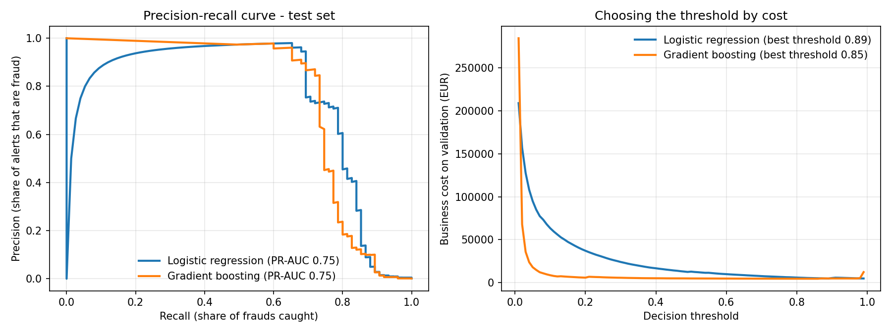

# Card Fraud Detection — SQL + scikit-learn

Detecting fraudulent card payments in a highly imbalanced dataset (0.17% frauds), with the analysis done in **SQL** and the models in **scikit-learn**. The decision threshold is chosen by **business cost**, not by a default 0.5.

## Data

[Credit Card Fraud Detection](https://www.openml.org/d/1597) (ULB Machine Learning Group): 284,807 transactions by European cardholders over two days, 492 frauds. Features V1–V28 are anonymised PCA components; `Amount` is in EUR. Rows are in chronological order. The data are loaded into a **SQLite** database and explored with SQL queries (`sql/analysis.sql`).

## Method

- **SQL analysis** (`sql/analysis.sql`): fraud rate overall, over time and by payment size; amounts of fraudulent vs legitimate payments; **CTEs and window functions** (`LAG`, running totals with `SUM() OVER`, `ROW_NUMBER() OVER (PARTITION BY ...)`, `RANK()`) for the fraud trend, the largest frauds in each amount band and the riskiest periods
- **Features:** V1–V28 and log(amount)
- **Time-based split:** first 60% of transactions for training, next 20% for validation, last 20% for test — the model never sees the future
- **Models:** logistic regression (baseline) and gradient boosting, both with class weights for the imbalance
- **Metrics:** PR-AUC, precision and recall (accuracy is meaningless when 99.8% of payments are legitimate)
- **Threshold by cost:** a missed fraud costs its amount, a false alarm costs 5 EUR of review; the threshold that minimises cost on the validation set is then applied to the test set

## Results (test set)

Test set = the last 20% of transactions in time (56,962 payments, 75 frauds worth 7,729 EUR). Threshold chosen on the validation set by business cost (missed fraud = its amount, false alarm = 5 EUR).

| Model | PR-AUC | Threshold | Precision | Recall | Frauds caught | False alarms | Cost (EUR) |
|---|---|---|---|---|---|---|---|
| No model | – | – | – | 0% | 0/75 | 0 | 7,729 |
| Logistic regression | 0.75 | 0.89 | 21% | 85% | 64/75 | 235 | **3,542** |
| Gradient boosting | 0.75 | 0.85 | 86% | 72% | 54/75 | 9 | 3,928 |



**From the SQL analysis:** frauds are 0.17% of payments but 60,128 EUR in total. The fraud rate is highest for very small payments (0.41% under 1 EUR, typical of "card testing" before a larger fraud) and for large ones (0.37% above 500 EUR), and it changes a lot over time (from 0.08% to 0.33% across ten consecutive blocks of transactions).

The window-function queries add two more findings:

- **Two risky periods.** Blocks 1 and 6 have almost twice the average fraud rate (1.89x and 1.85x) and together hold 37% of all frauds. The dataset covers two days, so these blocks most likely correspond to the night hours at the start of each day, when legitimate traffic is low.
- **A repeated pattern just below 100 EUR.** The three largest frauds in the 10–100 EUR band are all **99.99 EUR** and very close in time (transactions 14170, 14197, 14211) – consistent with a fraudster repeating the same amount while staying under a round limit. This kind of pattern is easier to spot in SQL than in a model.

## Key takeaways

- **Both models halve the cost of fraud** compared with no model (3.5–3.9k EUR vs 7.7k EUR), with the same ranking quality (PR-AUC 0.75).
- **They make different trade-offs:** logistic regression catches more frauds but raises 235 false alarms; gradient boosting raises only 9 but misses more. Which one is better depends on what a false alarm really costs – with a review cost above roughly 6–7 EUR, gradient boosting would win.
- **The threshold matters more than the model.** With the default 0.5 threshold, logistic regression would cost 9,946 EUR – *more than having no model at all*. Choosing the threshold by cost cut that to 3,542 EUR.
- **Caveat – thresholds are noisy with few frauds.** The validation set has only 57 frauds, so the chosen threshold does not always transfer: for gradient boosting, the default 0.5 would have done better on the test set (3,006 EUR). With more data I would choose the threshold with cross-validation over time and monitor it in production, since the fraud rate drifts.

## How to run

```bash
pip install -r requirements.txt
python main.py      # full pipeline: data -> SQLite -> SQL analysis -> models -> plots
python run_sql.py   # SQL analysis only (after the first run)
```

The dataset is downloaded automatically from OpenML the first time (about 150 MB).

## Project structure

```
├── main.py              # full pipeline
├── run_sql.py           # SQL analysis only
├── sql/analysis.sql     # exploratory SQL queries
├── src/
│   ├── data.py          # download and load into SQLite
│   ├── sql_analysis.py  # run the SQL queries with pandas
│   ├── model.py         # features, time split, models
│   └── evaluate.py      # PR-AUC, precision/recall, business cost, threshold
└── results/             # plots
```

## Tools

Python · SQL (SQLite) · scikit-learn · pandas · NumPy · matplotlib
